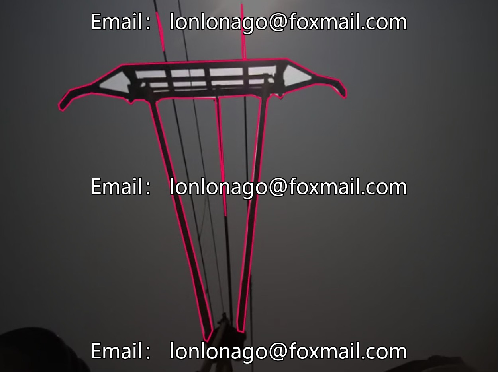
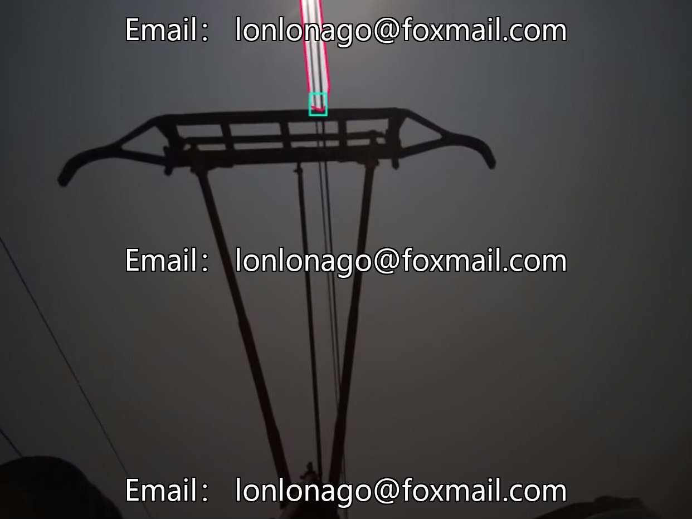
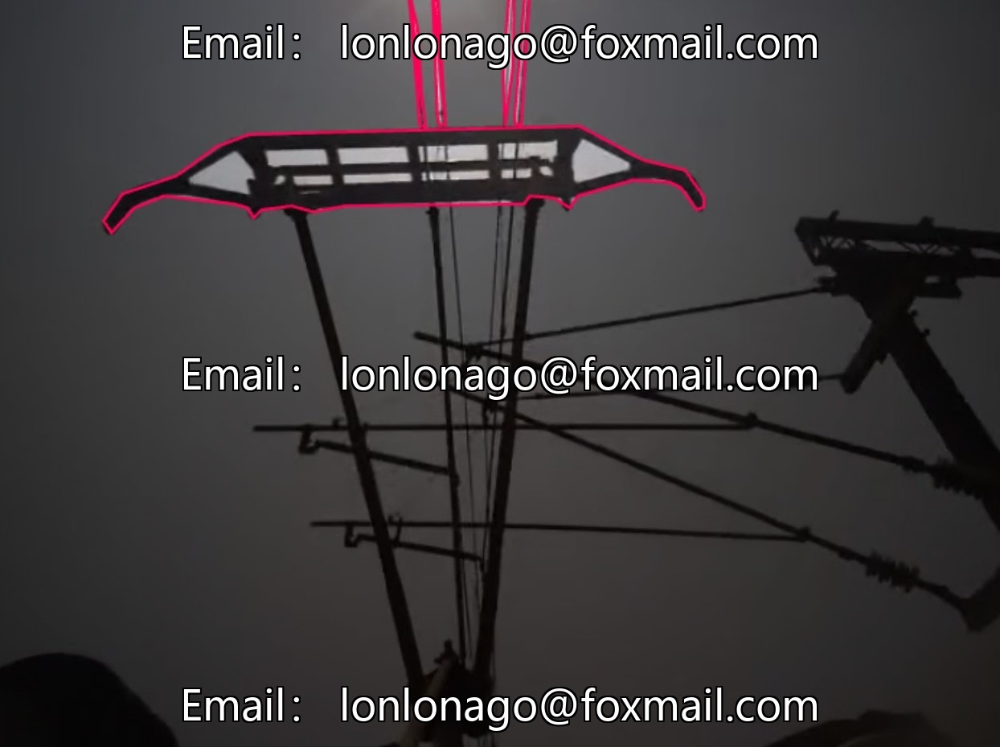
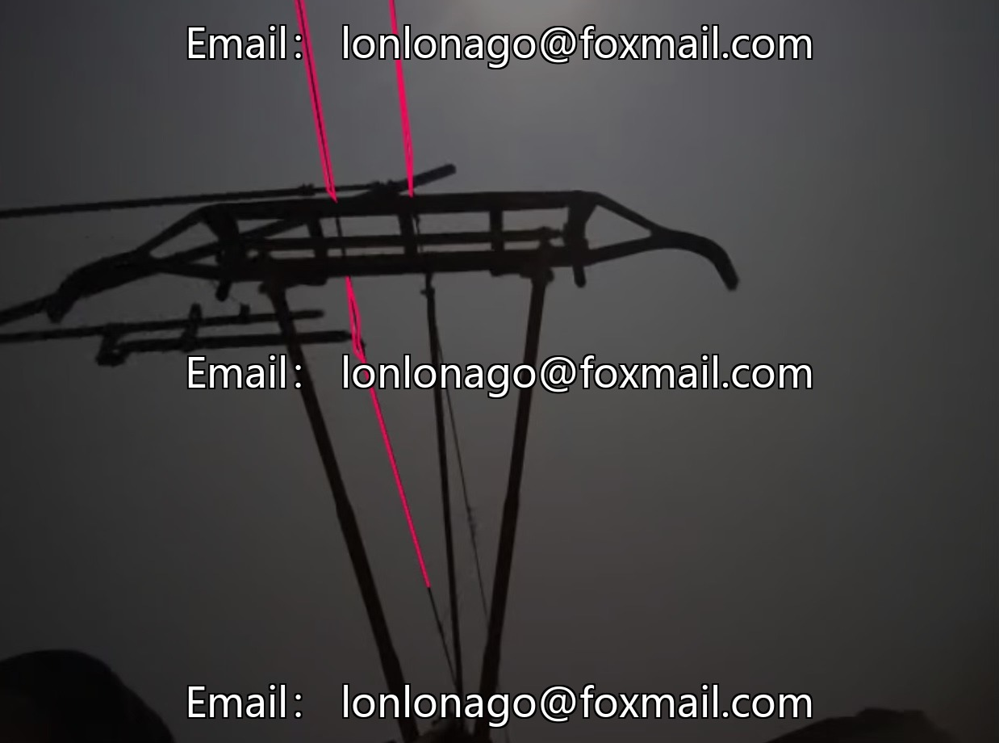
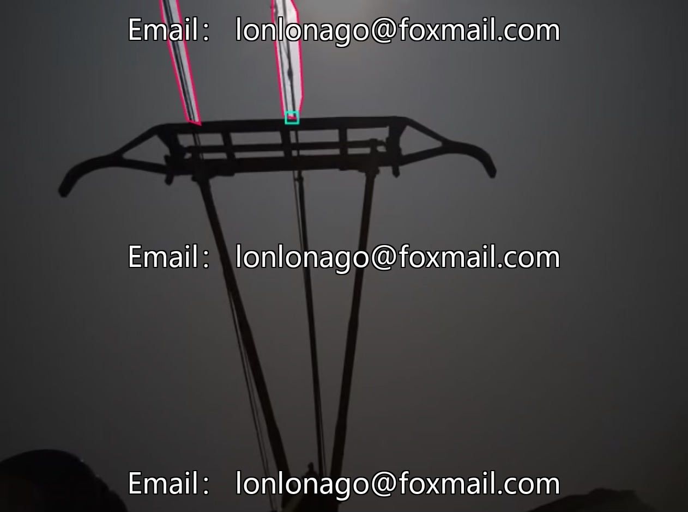

# Train Electrode Contact Point Recognition Dataset, 855 images, including cables and contact points

## Body

Train Electrode Contact Point Recognition Dataset, 855 images, including cables, contact points, reflective covers, electromagnets, and supplementary categories not clearly labeled, with 5 core detection categories. The data is primarily in image file format, supports mainstream deep learning frameworks, suitable for scenarios such as rail transit electromagnet target detection, intelligent railway fault early warning, and intelligent railway vehicle operation and maintenance.

Data covers different scenarios, model training is effective, supports algorithm research and development, and intelligent operation and maintenance. Virtual materials are sold on a one-time basis without return or refund.

Interested friends, click "I want".

## Images

## Payment

Here is a pay link on Stripe ( https://buy.stripe.com/3cs8yP7sY87d0vu9AB ). Please contact me lonlonago@foxmail.com after funding $89, and I will send you a complete data files , thank you!

